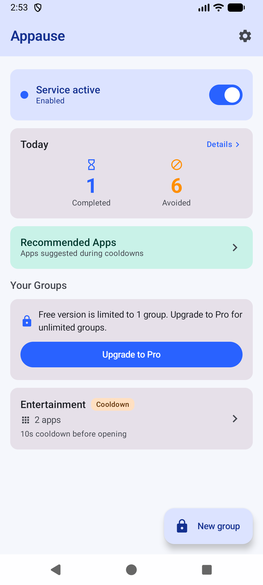
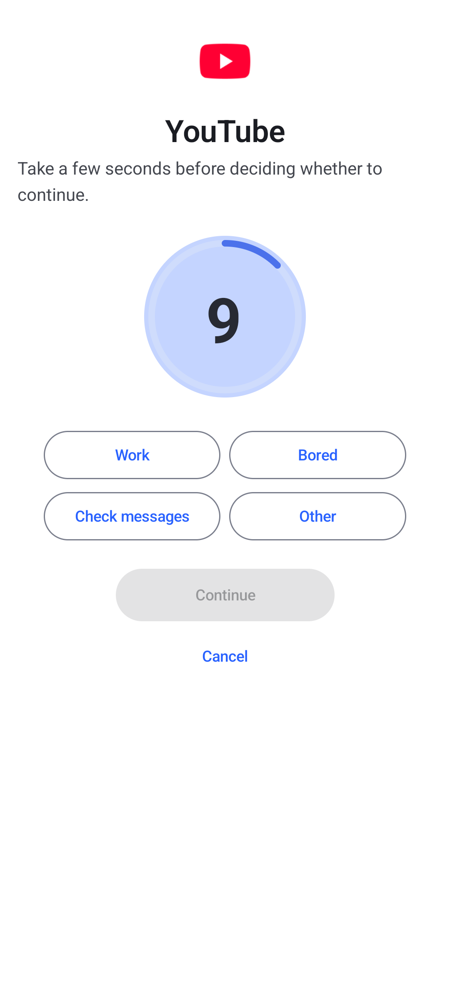
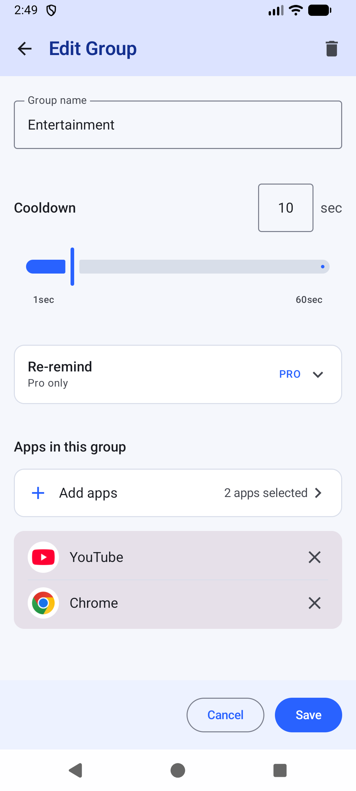
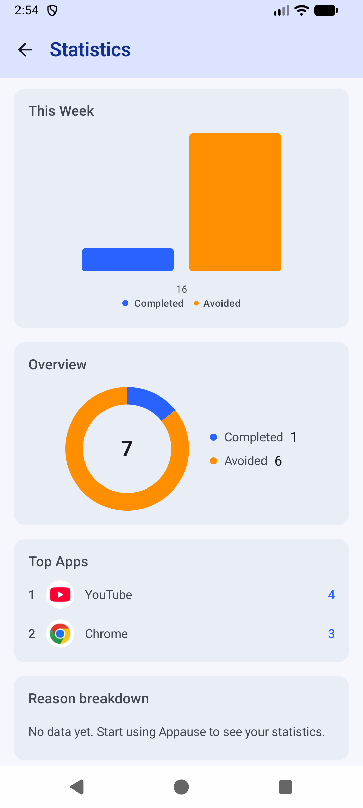
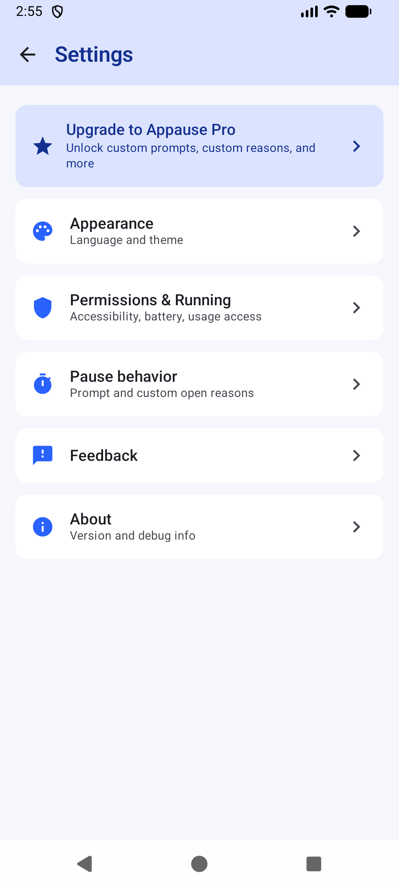
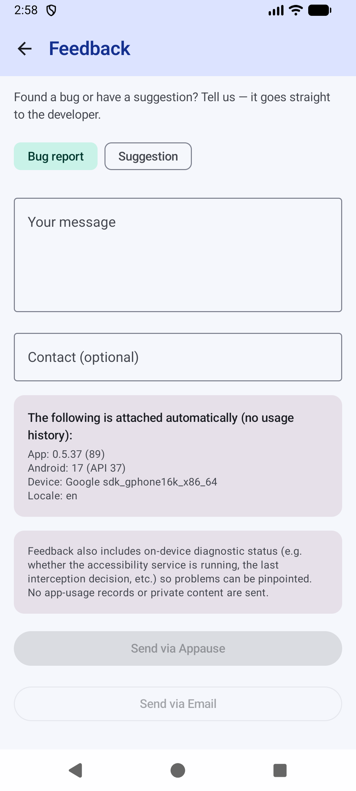

# Appause

[English](README.md) | [简体中文](README.zh-CN.md)

**App + Pause** — put a brief moment between the impulse and the app.

Appause is a local-first Android focus tool. You choose target apps, place them
in groups, and set a cooldown. When a target app comes to the foreground,
Appause shows a short pause screen so you can breathe and decide whether to
continue.

**Website:** [shmily0826.github.io/Appause](https://shmily0826.github.io/Appause/) · [中文](https://shmily0826.github.io/Appause/zh.html)

## Latest download: v0.5.48 Public Beta

Download the signed [Appause-v0.5.48.apk](https://github.com/Shmily0826/Appause/releases/download/v0.5.48/Appause-v0.5.48.apk) directly from GitHub.
For downloads from China, use [Lanzou](https://shmily0826.lanzoup.com/b01eunt29a), password **1234**.
Both channels provide the same APK.

- Package: `com.appause.android`
- versionCode: `100`
- SHA-256: `b6117fd4fe5ee1d8b2d9d421bdb8573bd1a515a61ac12932acbdd31240eadded`

The signed APK passed offline checks and core HyperOS device checks.
See the [v0.5.48 public beta release](https://github.com/Shmily0826/Appause/releases/tag/v0.5.48) for release notes.
The English landing page prefers GitHub; the Chinese page prefers Lanzou.

Future public release APKs use `Appause-v<version>.apk`. The Android
`versionCode` is internal metadata and is not part of the public filename.
See [docs/INSTALL.md](docs/INSTALL.md) before the first sideload.

## What it does

- **App groups** — organize target apps and manage a shared cooldown.
- **Pause screen** — a visible countdown before a target app opens. Continue is
  available after the countdown; explicit Cancel returns to the home screen.
- **Session and re-remind** — optionally receive another nudge while staying in
  a target app. Leaving for the home screen, or for a longer period, re-arms the
  cooldown.
- **Usage statistics** — review activity and reasons you chose to continue.
- **Recommended apps and dark mode** — useful setup shortcuts and a system-aware
  theme.
- **OEM guidance** — setup explains battery, auto-start, and background-service
  settings that matter on Xiaomi/HyperOS and similar devices.
- **Feedback** — Settings → Feedback lets you review a structured diagnostic
  snapshot before choosing to send a bug report or suggestion.
- **Appause Pro** — unlimited groups, re-remind, a custom pause prompt, and
  custom open reasons. Start a one-time 7-day trial on the Pro page; after it
  ends, request a free lifetime code through Settings → Feedback. There is no
  subscription or paid tier, and the core features stay free.

## Screenshots

| Home | Pause screen | Groups |
|---|---|---|
|  |  |  |

| Statistics | Settings | Feedback |
|---|---|---|
|  |  |  |

## Privacy and permissions

Appause stores groups, cooldowns, and statistics on the device using Room and
DataStore. It has no account, ads, analytics SDK, or cloud sync. The
AccessibilityService reads only the foreground package name;
`canRetrieveWindowContent` is `false`, so Appause does not read screen content,
messages, screenshots, or keystrokes. See [PRIVACY.md](PRIVACY.md) for the
complete policy.

| Setup item | Why it is used |
|---|---|
| **AccessibilityService — required** | Detects which app is in the foreground so configured target apps can be paused. |
| **Battery unrestricted — required for reliable background operation on Xiaomi/HyperOS and similar ROMs** | Prevents the system from killing the detection service. Also allow auto-start and, where available, lock Appause in recents. |
| **Usage Access — optional, recommended** | Confirms the genuinely foreground app locally and reduces false triggers from notifications. |
| **Display over other apps — optional fallback** | The normal pause screen uses an accessibility overlay. Grant this only if a device does not display the pause screen, so Appause can try its compatibility fallback. |
| **Notifications — optional for the ongoing status notification** | Android 13+ may ask for notification permission; it does not provide foreground-app detection. |
| **Internet — only for chosen actions** | Used when you explicitly start the Pro trial or redeem a lifetime activation code; the server-issued token is then verified locally, including expiry and device binding, and persisted for offline entitlement checks. Feedback is also sent only when chosen. It is not used for automatic license checks or ordinary status checks. |

Appause is an accessibility / habit-forming aid, not a monitoring, security, or
medical tool. You can always disable the service or change your groups.

## Requirements

- Android 8.0 or newer (API 26+)
- Release package: `com.appause.android`
- Direct APK distribution through GitHub Releases; Appause is not distributed
  through Google Play

## Build from source

The project uses Kotlin, Jetpack Compose, Room, DataStore, and Gradle Kotlin
DSL. Use JDK 17 and an Android SDK with API 35 available.

```bash
./gradlew testDebugUnitTest
./gradlew assembleDebug
./gradlew assembleRelease
```

Release signing uses a local, git-ignored signing configuration. Never commit a
keystore, password, private key, activation code, or Worker secret.

## Testing status

v0.5.48 is a public beta. Before release, its core interception and in-place
upgrade were checked on one Xiaomi HyperOS phone running Android 16, and the
unit test suite runs in CI on every push. That does not cover every device, ROM,
or long-running scenario. If Appause misbehaves on your phone, please
[open an issue](https://github.com/Shmily0826/Appause/issues).

## Install and feedback

- [Install guide](docs/INSTALL.md)
- [Privacy policy](PRIVACY.md)
- [GitHub Issues](https://github.com/Shmily0826/Appause/issues)
- [v0.5.48 Public Beta Release](https://github.com/Shmily0826/Appause/releases/tag/v0.5.48)

## License

[MIT](LICENSE) © 2026 Appause authors.
