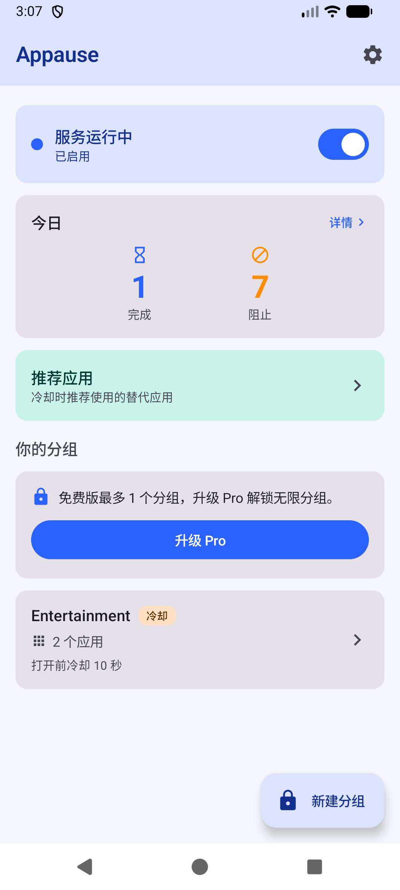
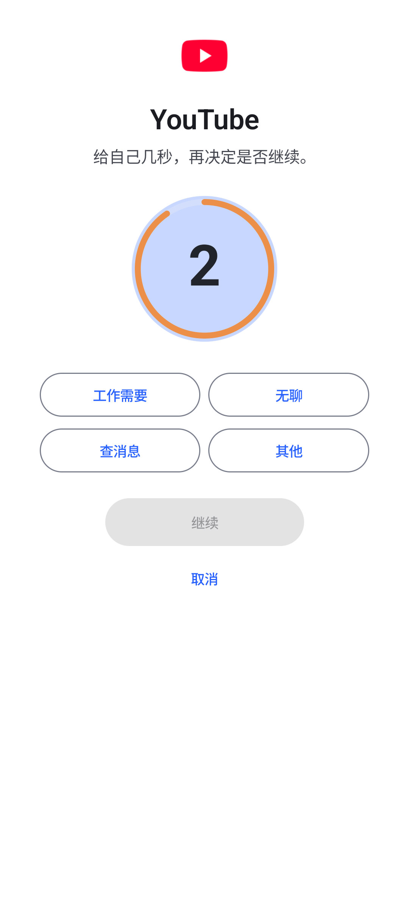
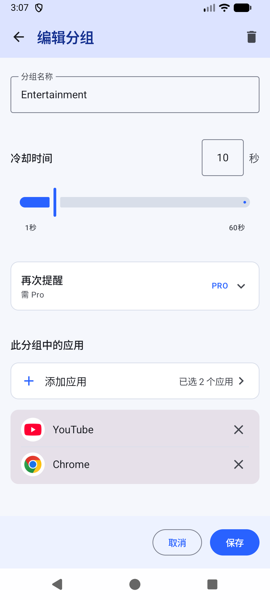
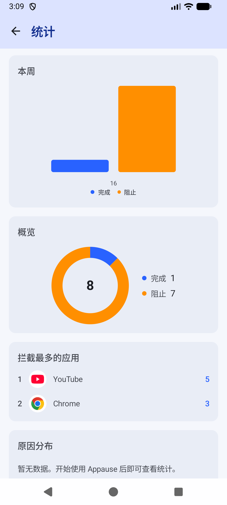
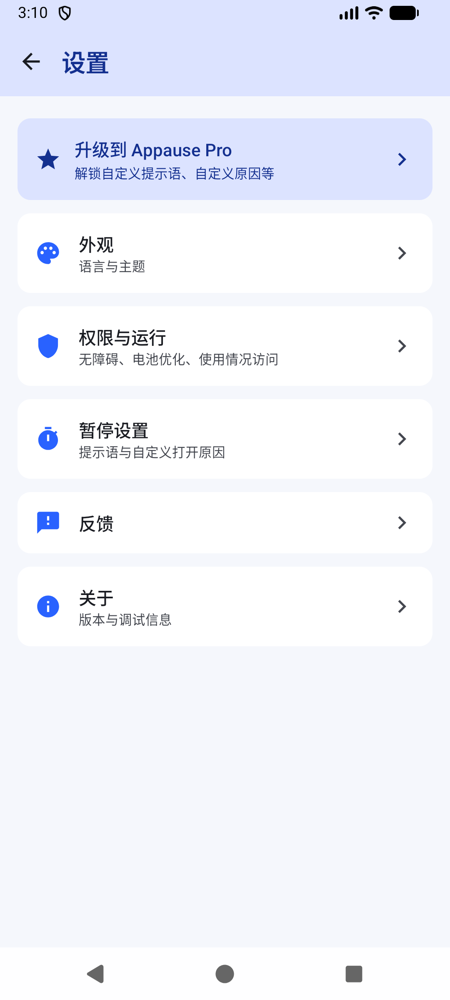
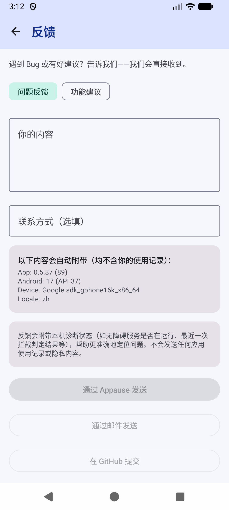

# Appause

[English](README.md) | [简体中文](README.zh-CN.md)

**App + Pause** — 在打开应用的冲动和行动之间，留出片刻。

Appause 是一款以本地存储为主的安卓专注工具。你可以选择目标应用、设置分组和冷却时间。
当目标应用进入前台时，Appause 会显示一段简短的暂停倒计时，让你决定是否继续。

**官网：** [中文](https://shmily0826.github.io/Appause/zh.html) · [English](https://shmily0826.github.io/Appause/)

## 最新下载：v0.5.48 公开测试版

从[蓝奏云](https://shmily0826.lanzoup.com/b01eunt29a)下载 `Appause-v0.5.48.apk`，提取密码 **1234**。
也可以从 [GitHub 直接下载](https://github.com/Shmily0826/Appause/releases/download/v0.5.48/Appause-v0.5.48.apk)。
两个渠道提供相同的签名安装包。

- 包名：`com.appause.android`
- versionCode：`100`
- SHA-256：`b6117fd4fe5ee1d8b2d9d421bdb8573bd1a515a61ac12932acbdd31240eadded`

签名安装包已通过离线检查及 HyperOS 真机核心功能检查。
本版变更见 [v0.5.48 发布说明](https://github.com/Shmily0826/Appause/releases/tag/v0.5.48)。
英文官网优先使用 GitHub 下载，中文官网优先使用蓝奏云。

后续公开发布的 APK 使用 `Appause-v<版本号>.apk` 命名。
`versionCode` 是内部版本编号，不属于公开文件名。
首次安装前可查看[安装指南](docs/INSTALL.md)。

## 功能

- **应用分组**：将目标应用放入分组，共用冷却设置。
- **暂停页面**：打开目标应用前显示倒计时，结束后可以继续；点击取消会返回桌面。
- **会话与再次提醒**：可选择在目标应用内停留一段时间后再次提醒。返回桌面或离开一段时间后，下次打开会重新触发冷却。
- **使用统计**：回顾使用情况，以及自己选择继续打开应用的原因。
- **推荐应用与深色模式**：设置替代应用入口，并跟随系统切换主题。
- **厂商设置指引**：说明小米 / HyperOS 等系统上的电池、自启动和后台运行设置。
- **反馈**：通过「设置 → 反馈」查看整理好的诊断信息，再自行决定是否发送问题或建议。
- **Appause Pro**：包含无限分组、再次提醒、自定义暂停提示和打开原因。可在 Pro 页面开启一次七天试用；结束后，通过「设置 → 反馈」申请免费永久授权码。没有订阅或付费版本，核心功能保持免费。

## 截图

| 首页 | 暂停页面 | 分组 |
|---|---|---|
|  |  |  |

| 使用统计 | 设置 | 反馈 |
|---|---|---|
|  |  |  |

## 隐私与权限

Appause 通过 Room 和 DataStore 在本机保存分组、冷却设置和统计。
没有账号、广告、分析 SDK 或云同步。无障碍服务通过前台应用的包名判断是否需要暂停；
`canRetrieveWindowContent` 设为 `false`，不读取屏幕内容、聊天消息、截图或键盘输入。
完整说明见[隐私政策](PRIVACY.md#中文简体)。

| 设置项 | 用途 |
|---|---|
| **无障碍服务 — 必需** | 检测当前处于前台的应用，以便暂停你设置的目标应用。 |
| **电池不受限制 — 小米 / HyperOS 等系统上的后台运行设置** | 减少系统对检测服务的后台限制。同时允许自启动，并在系统支持时锁定最近任务。 |
| **使用情况访问 — 可选，建议开启** | 在本机确认前台应用，减少通知等情况引起的误触发。 |
| **显示在其他应用上层 — 可选的兼容性备用方案** | 暂停页通常使用无障碍覆盖层。只有设备无法显示暂停页时，才需要尝试开启此权限。 |
| **通知 — 可选** | 显示持续运行的状态通知。安卓 13 及以上可能询问此权限；它不用于检测前台应用。 |
| **网络 — 仅在你主动操作时使用** | 开始 Pro 试用或兑换永久授权码时联网，返回的授权令牌在本机验证并保存，之后可离线检查授权。反馈也只会在你主动发送时传出。不进行自动联网授权检查或日常状态检查。 |

Appause 是辅助用户调整使用习惯的无障碍工具，不是监控、安全或医疗工具。
你随时可以关闭服务或调整分组。

## 系统要求

- 安卓 8.0 及以上（API 26+）。
- 正式包名：`com.appause.android`。
- 通过 GitHub Releases 提供 APK 下载，目前未上架 Google Play。

## 从源码构建

项目使用 Kotlin、Jetpack Compose、Room、DataStore 和 Gradle Kotlin DSL。
构建需要 JDK 17，以及包含 API 35 的 Android SDK。

```bash
./gradlew testDebugUnitTest
./gradlew assembleDebug
./gradlew assembleRelease
```

正式版签名使用不纳入 Git 的本地配置。不要提交密钥库、密码、私钥、激活码或 Worker 密钥。

## 测试情况

v0.5.48 是公开测试版。发布前，已在一台运行安卓 16 的小米 HyperOS 手机上检查核心拦截和覆盖升级流程；
CI 会在每次推送时运行单元测试。这些检查尚未覆盖所有设备、系统和长时间运行场景。
如果 Appause 在你的手机上出现问题，欢迎[提交 Issue](https://github.com/Shmily0826/Appause/issues)。

## 安装与反馈

- [安装指南](docs/INSTALL.md)
- [隐私政策](PRIVACY.md#中文简体)
- [GitHub Issues](https://github.com/Shmily0826/Appause/issues)
- [v0.5.48 发布说明](https://github.com/Shmily0826/Appause/releases/tag/v0.5.48)

## 开源协议

[MIT](LICENSE) © 2026 Appause authors.
